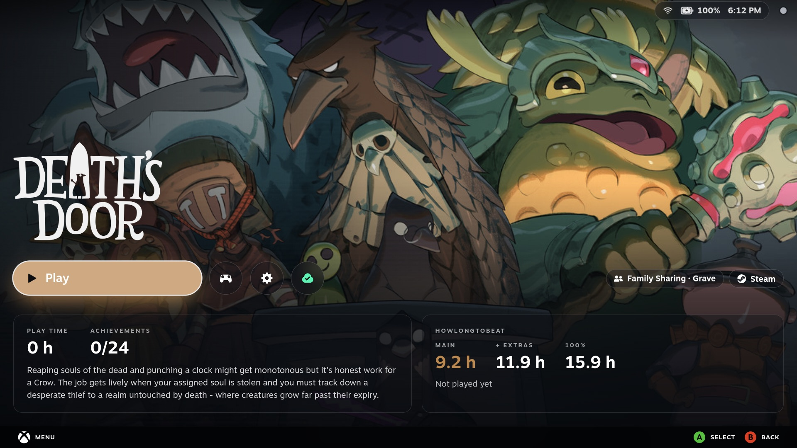
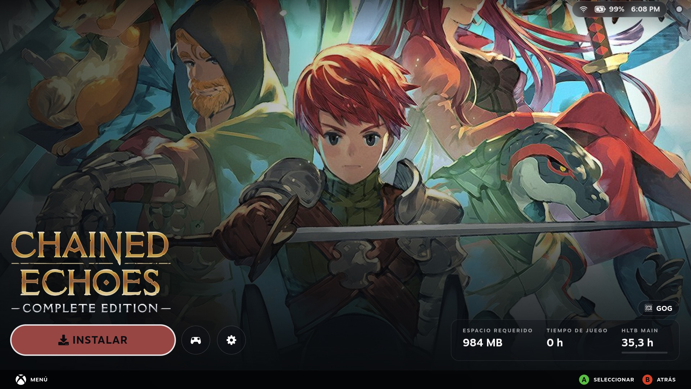
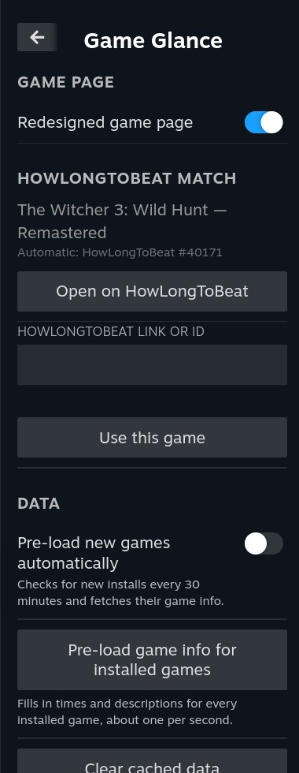

# Features and settings

This is the full description of what Game Glance does. The [README](../README.md) has the short version.

## The game page

More screenshots: the Clean look in Spanish, and the Quick Access panel

- **Full-screen art.** The game's hero art fills the screen by default (your custom SteamGridDB art when you have set some).
  Choose **Fit** under Appearance → Hero art to show the whole image over a blurred art backdrop, on Home and both game-page layouts.
  Steam's Activity, Your stuff, Community and Game info tabs are one press down.
- **HowLongToBeat.** Main story, Main + Extras and 100% times, a bar toward the next one you have not reached, and
  how many hours are left.
- **Info card.** Your play time, achievements and the game's description, in your Steam language.
- **Play row.** A pill-shaped Play button (with the "Play from" arrow some games have), round controller and settings
  buttons, and Steam Cloud as a small icon coloured by its sync state.
- **Store pill.** Where the game comes from, with the store's icon: Steam, GOG, Epic, Amazon, Battle.net, Ubisoft,
  Xbox Cloud or Heroic. A game borrowed through **Steam Families** gets a second pill with the owner's name
  ("Family Sharing · Lender").
- **Clean look** (optional): only the art and one row at the bottom (Play, the buttons, and a small card with your play
  time, achievements and HowLongToBeat's main story), without the description and HowLongToBeat cards.
- **Non-Steam games.** Games added by [Heroic](https://heroicgameslauncher.com) or
  [Unifideck](https://github.com/mubaraknumann/unifideck) get their store, times and description too. A Unifideck game's
  page looks and works like a Steam game's: its Play row in the same place, the buttons in Steam's order, its own play
  time, last played and install size (in Unifideck's language), and its cloud saves.
- **Works offline.** Times and descriptions are kept on the device. Quick Access can pre-load them for every installed
  game, and new installs are picked up automatically.

In Spotlight Home's look, tap the info card for Steam's Game Info tab, or the HowLongToBeat card for the game's page on
howlongtobeat.com. With the controller, Down from the Play row selects the cards and A opens them.

With Spotlight Home on (or the Clean look), the page takes Spotlight Home's look: the game's title or logo with "Last
played" under it, just above a larger Play row in the game's colour, and the status bar at the top. With both off, the
page keeps its classic look.

## Spotlight Home

https://github.com/user-attachments/assets/e12cb973-b34c-4dff-8f94-b0b59762a67a

*Spotlight Home on a ROG Xbox Ally: picking games, then opening one in the Clean look and in the Spotlight look.*

An optional new Home screen, off by default (Quick Access → Game Glance → Spotlight Home).

- **One game at a time.** The selected game fills the screen with its art, its title (or logo) and when you last played
  it, chips for play time, achievements and HowLongToBeat's main story, a Play button and the game's buttons. The
  accent colour follows each game's art. The chips are filled in ahead of time for every game in the row, so they are
  there the moment you land on a game.
- **The games row.** Your recent games (up to 20, as many as Steam's own Home), or one of your collections (see the
  Games row setting below). Games new to your library join the recent games, marked NEW, and demos show as on Steam's
  Home. As on Steam's Home, the last played game is the wide card and the selection moves to the middle of the screen,
  the games before it faded on the left (or, with Games row style Spotlight, the selected game opens into a wide card at
  the left). Games not installed on this device are grey until selected. The row ends in a Library card.
- **Controls.** Left and Right pick a game, A opens its page, up reaches Play and the buttons. **L1 and R1** pick the
  previous or next game from anywhere above the tabs and put focus on Play (hold to keep going), so a game starts in two
  presses. Held, the d-pad and stick go at the same steady pace as L1 and R1. While you press quickly through the games
  only the highlight moves; the art and colour catch up once you stop. The gear button, or View/Select, opens Steam's own
  menu for the game.
- **Touch.** On a handheld's touchscreen, tap a game to select it and tap it again to open it; tap the Library card,
  or a game in the "back to start" preview, the same way. Swipe the row to move through the games (it follows your
  finger, a flick glides on, slowing down, and bounces off the ends; flick on from the Library card to go back to the
  first game), swipe up anywhere on Home for the tabs and down to come back, swipe a
  tab's row sideways, and tap a tab or a card. The controller carries on from wherever your finger left off.
- **Mouse.** Click and drag as with a finger; the wheel moves through the games one card a notch (with the tabs up,
  through the row under the cursor) and stops at the ends; anything clickable under the cursor gets a faint ring, on Home and
  the game page (the games, buttons and tabs; a feed card and the game page's cards also lift a little). Only a mouse
  that moves turns it on; a touch or the controller turns it off. While it is on, the buttons' controller focus look
  stays hidden (a clicked button no longer looks pressed when you come back to the page); the selected game keeps its look. A chevron above the games row, shown only in mouse mode, raises the tabs; with
  them up it sits in the middle of the tabs row, pointing up, and brings the games back.
- **Opening a game.** Home turns into the game's page: the art stays put while the title, Play and the buttons move to
  their places on the page and the chips grow into its cards.
- **Steam Cloud.** For games with cloud saves, Steam's and Unifideck's, a cloud button shows the sync state and opens
  Steam's sync dialog when there is a problem.
- **Status bar.** The time (12 or 24 hours, as set in Steam's Settings → System), battery (a bolt while charging, red
  under 20%), Wi-Fi or wired, and a dot for your own online status, at the top right, on Home and the game page. It steps
  aside for Steam's own top bar when you move up to it or open a Steam menu.
- **Press down for more.** Home itself stays clean; one press down brings up three tabs (L1 and R1 switch between them,
  with Steam's tab sound). Each tab can be turned off in Quick Access; a tab that is off loads nothing, and with all three
  off Home has no feed at all:
  - **What's new:** news for your games, and the games recently updated on this device.
  - **Friends:** your friends, in game first, then online, away and offline; A on a friend in a game you can join asks,
    then joins them. Under them, the games popular among your friends, with their pictures.
  - **Recommended:** Play next from your library, and, with Show wishlist deals on, up to six wishlist games on sale
    (the new price, then the old one struck through).
- **A comfortable size.** Text, cards and buttons are drawn a little larger than in earlier versions (about 8.6% on 16:9 screens, 7.3% on the Deck), on Home, the game page and the screensaver alike.
- **Safe.** If anything in Spotlight Home fails, you get Steam's own Home instead of a broken screen.

## Screensaver

Steam's screensaver (Settings → Customization → Screensaver, Game Slideshow) drawn by Game Glance, on by default
(Quick Access → Game Glance → Screensaver).

- **Your games, your art.** The games of Home's Games row (your recent games or the chosen collection), in shuffled
  order, each with its art filling the screen, your custom SteamGridDB art first. Steam's own slideshow always shows
  Steam's recent games.
- **Logo.** The game's logo at the bottom left, cropped and sized as on Home (its name when it has none).
- **Stats.** A small card at the bottom right: your play time, the HowLongToBeat time you are working toward (the
  first one you have not reached, with a bar) and your achievements. It stays readable on any screen shape.
- **Status bar.** Home's clock, battery and connection at the top right.
- **Like Steam's.** 20 seconds per game, a 2 second crossfade and a slow drift of the art. Logo, Status bar and Stats are
  each a switch; with all three off only the art is left. **Preview** shows it at once.
- Game Glance's screensaver needs a Steam client with the screensaver; on an older one Quick Access says so and Steam's
  stays as it is. With Steam's Bouncing Logo chosen, Game Glance leaves it alone.

## Settings

Quick Access (…) → Game Glance:

| Setting | Default | What it does |
|---|---|---|
| Game Glance | On | The full-screen game page. Off gives Steam's own game page. |
| Clean look | Off | The game page with only the art and one row at the bottom. |
| Spotlight Home | Off | The new Home, and its look on the game page. Off returns Steam's Home at once. |
| Status bar | On | The clock, battery, connection and online status at the top right. |
| Game logo | Off | The game's logo in place of its name, on Home and the game page. A game without a logo keeps its name. Each logo is cropped to its artwork and sized so that wide and compact logos look about equally big. |
| Hero art | Fill | Appearance → Hero art. Fill covers the screen; Fit shows the whole image over its blurred art backdrop on Home and both game-page layouts. |
| Games row | Recent Games | What Home's row shows: your recent games, or one of your Steam collections (Favorites, Locally Installed Games and your own). With a collection, **Sort By** offers Last Played, Alphabetical or Date Added to Library, and the line under the title starts with the collection's name. |
| Games row style | Steam | How the row moves. Steam: the last played game is the wide card and the selection moves to the middle of the screen, as on Steam's Home. Spotlight: the selected game widens and the row slides it to the left edge. Minimal: small portrait cards throughout, with Steam-style scrolling. |
| Gray out uninstalled games | On | Unselected, uninstalled Steam games appear in gray in every Home row style. Off keeps their artwork in color. Selected games remain in color. |
| What's new, Friends, Recommended | On | Home's feed tabs. A tab that is off is not shown and loads nothing; all three off removes the feed (Down does nothing). |
| Show wishlist deals | Off | Wishlist games on sale in the Recommended tab (see [Privacy](../README.md#privacy)). Shown while Recommended is on; with Recommended off nothing is sent. |
| Pre-load new games automatically | On | Fetches times and descriptions for new installs, every 30 minutes. |
| Game Glance screensaver | On | Steam's screensaver (Game Slideshow) with your Games row and its art. Off returns Steam's own. |
| Logo, Status bar, Stats (Screensaver) | On | The screensaver's logo, status bar and stats card. All three off: only the art. |

Also in Quick Access:

- **HowLongToBeat match:** if a game matches the wrong entry or none, paste its HowLongToBeat link.
- **Pre-load game info for installed games:** fetches times and descriptions for every installed game, about one per
  second. A game that does not answer is skipped, and Stop ends it at once.
- **Clear cached data.**
- **Screensaver → Preview:** shows the screensaver at once (any button ends it).
- **Updates:** the installed version, **Update to …** when a newer release is out, and **Check for updates**.

## Your language

Game Glance follows Steam's language and uses Steam's own words wherever Steam has them ("Última sesión" and "Tiempo de
juego" in Spanish, the collection and sort names, the cloud states and more). Unifideck's labels come from Unifideck. A
few words with no Steam equivalent stay in English: the HowLongToBeat column names and this Quick Access panel (see
[localization.md](localization.md)).

## New in 3.6.0

- **Hero art: Fill or Fit:** show the whole artwork on Home and both game-page layouts, including the opening transition.
- **Home content controls:** choose which feed tabs appear and whether uninstalled games use gray artwork. Settings that depend on another switch appear only while it is enabled.
- **Larger default layout:** Home, game pages, the status bar and screensaver use a fixed larger layout, with adjustments for different screen shapes.
- **Transition and browsing polish:** shared information-card layout through the Home-to-page handoff, stable store/Family Sharing pills while browsing, and one moving pill pair when opening a game.

See the [3.6.0 release notes](release-notes/3.6.0.md) for details.

## Included from 3.5.0

- **Cloud status badge (#64):** the cloud circle on Home and the game page shows one white cloud, like the other buttons, with the sync state as a small dot at its top right: green synced, yellow syncing, red failed, grey offline. Unifideck games keep Unifideck's own look, and the page without Spotlight Home keeps its coloured icon.
- **Controller battery:** each connected Bluetooth controller's battery in the status bar, before the system battery (lowest first, at most two, then +n; red at 20% or below), read from the system's Bluetooth service so it matches Steam's Bluetooth settings. The built-in controller and USB controllers are not shown, and charging is not shown. Checked on the Ally with an 8BitDo Ultimate 2C.
- **Version choice:** select an installable stable release from 3.5.0 onward in Quick Access → Game Glance → Updates. Decky asks before an upgrade or downgrade. Original release assets are preserved. The 3.5 upgrade/downgrade round trip and cancellation were checked on the Ally.
- **Minimal games row:** a third style with small portrait cards throughout and Steam-style scrolling. The existing Steam and Spotlight styles remain available; all three were checked on the Ally.
