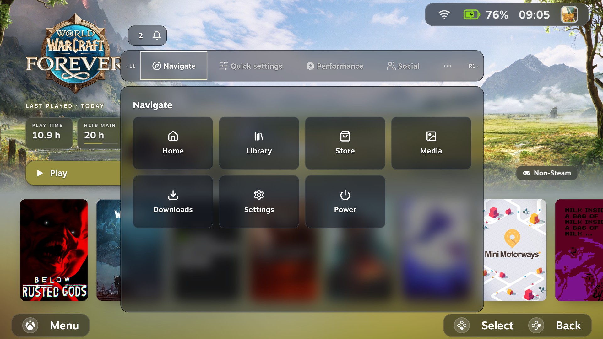
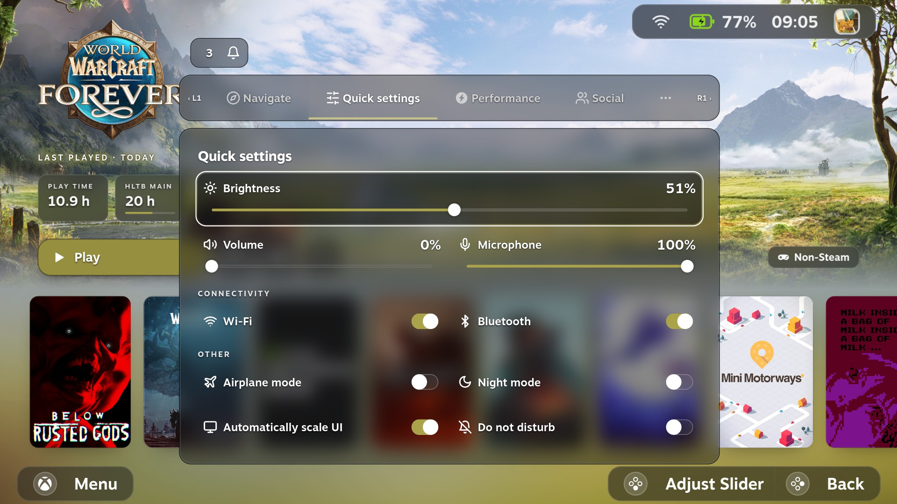
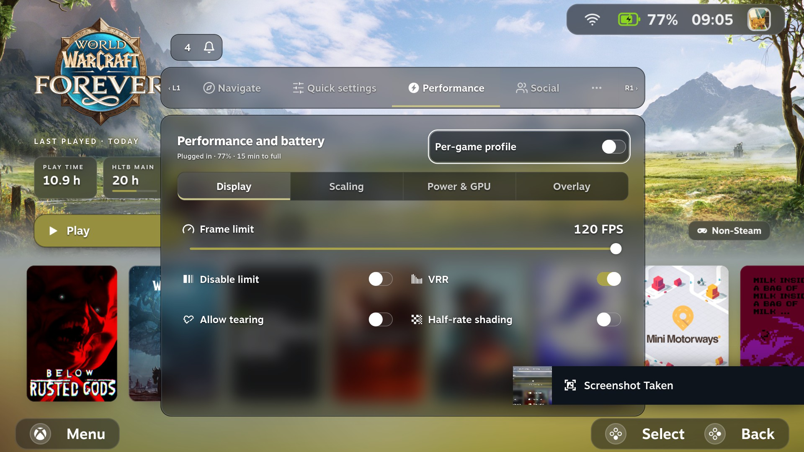
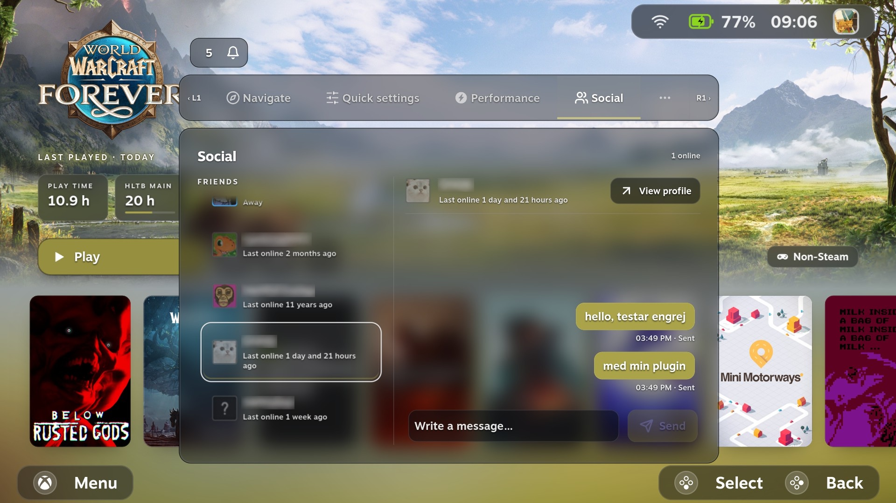
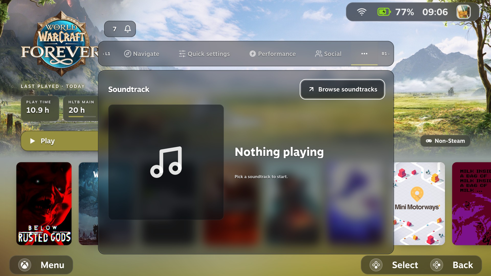
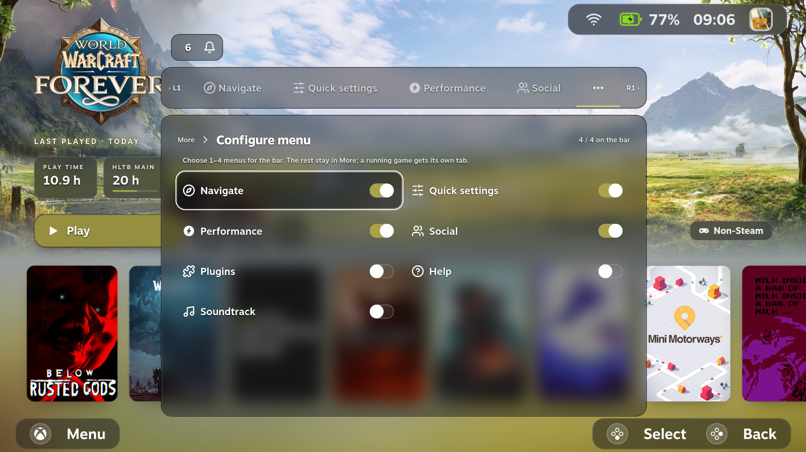
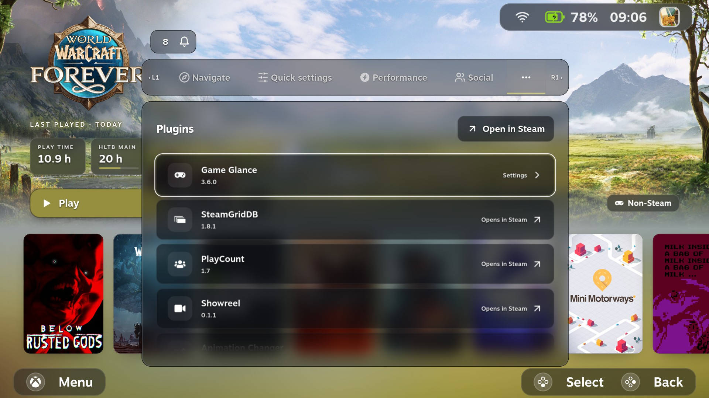

# Game Glance 4.0.0-rc.1

The first 4.0 prerelease brings library search and a redesigned menu to Steam Gaming Mode. I’m putting it out early to get feedback on how it feels to use with a controller on real devices.

[Watch the 36-second demo](https://github.com/michpalm/game-glance/releases/download/v4.0.0-rc.1/game-glance-4.0-demo.mp4)

## What’s new

- **Library Search.** Find games, demos, and shortcuts in your Steam library from the top bar and open their game pages. Dismiss the keyboard to browse the results, then select the search field to reopen it. Use Steam’s Store for store search.
- **Two controller keyboards.** Choose a movable Compact keyboard or a dual-stick Radial keyboard for Search and Social. The QWERTY-family radial layouts group letters by typing hand and row. Move the text cursor with the D-pad or arrow keys.
- **Optional Game Glance menu.** A frosted menu with pinning, Steam navigation shortcuts, Quick Settings, Performance, and an In game page with shortcuts for the running game. Supported controls depend on the device.
- **Social, Notifications, Soundtrack, and Plugins.** Open a direct Steam chat, act on notifications, control Steam soundtrack playback, and open Game Glance settings from the Plugins section.
- **Shared status bar and footer.** The same visual style carries across Home and game pages. With the interactive bar enabled, press Up from the game page’s Play row to enter it. Wi-Fi, battery, clock, and avatar open Internet, Power, System, and your Steam profile. Returning from a status shortcut preserves the selected Home game.
- **Optional Steam Settings restyle.** A compact layout with frosted artwork and native settings controls. Enable **Restyle Steam Settings** under **Game Glance → Menu** with the Game Glance menu enabled. The restyle defaults to off.
- **Choose version inside the menu.** **Game Glance → General → Choose version** lists published versions in the menu itself, with **Show prereleases** for test builds. Picking one hands over to Decky’s own confirmation. The same list is in **Quick Access → Game Glance → Updates**.
- **Visual and integration polish.** Clearer menu edges on dark scenes, adjustable Home and game-page shading, smoother handoffs, and improved Unifideck cloud and Resume/Stop controls.

## Install and roll back

From **Game Glance 3.6.1**, open **Quick Access → Game Glance → Updates → Choose version**, select **Show prereleases**, pick **4.0.0-rc.1** in the list, and select **Install 4.0.0-rc.1**. Decky asks you to confirm. Earlier versions need [3.6.1](https://github.com/michpalm/game-glance/releases/tag/v3.6.1) first, or the manual install below.

For a manual install:

1. Download the attached `game-glance.zip` and save it to your device.
2. In Gaming Mode, open **Decky → Settings → Developer → Install plugin from ZIP** and select the file. Enable Decky’s developer options if needed.
3. Open Game Glance settings to enable the menu and choose the features you want to try.

Automatic update checks stay on the stable channel. Prereleases are only installed when you choose one. To return to stable, open **Game Glance → General → Choose version** in the menu (or **Quick Access → Game Glance → Updates → Choose version**) and select **3.6.1**, or install the [stable 3.6.1 ZIP](https://github.com/michpalm/game-glance/releases/tag/v3.6.1) through Decky. Your settings are kept either way.

## Screenshots

| | |
| --- | --- |
|  |  |
| **Quick settings** | **Performance** |
|  |  |
| **Social** (friend names blurred) | **Soundtrack** |
|  |  |
| **Configure menu** | **Plugins** |

## Known issues

**Taking a screenshot with the in-game Game Glance menu open can restart Gaming Mode.** This has been reproduced on the ROG Ally running SteamOS 3.9.5 with compositor frost active. The crash can interrupt the running game. Close the menu and let it disappear before taking a Steam screenshot. [Upstream Gamescope ReShade screenshot issue](https://github.com/ValveSoftware/gamescope/issues/2416)

## Feedback

I’d especially like to hear how Search and the keyboards feel with a controller, whether the menu reads well on your display, and whether focus returns where you expect after opening a page or pressing B. Include your device, OS version, handheld or docked mode, and the steps that led to the issue. [Report an issue](https://github.com/michpalm/game-glance/issues/new/choose)
